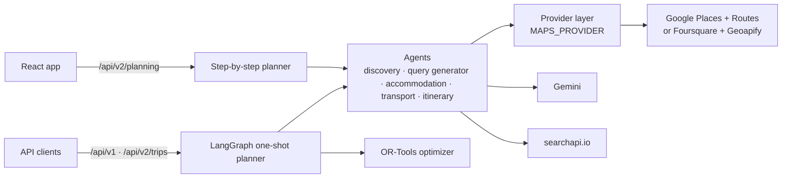
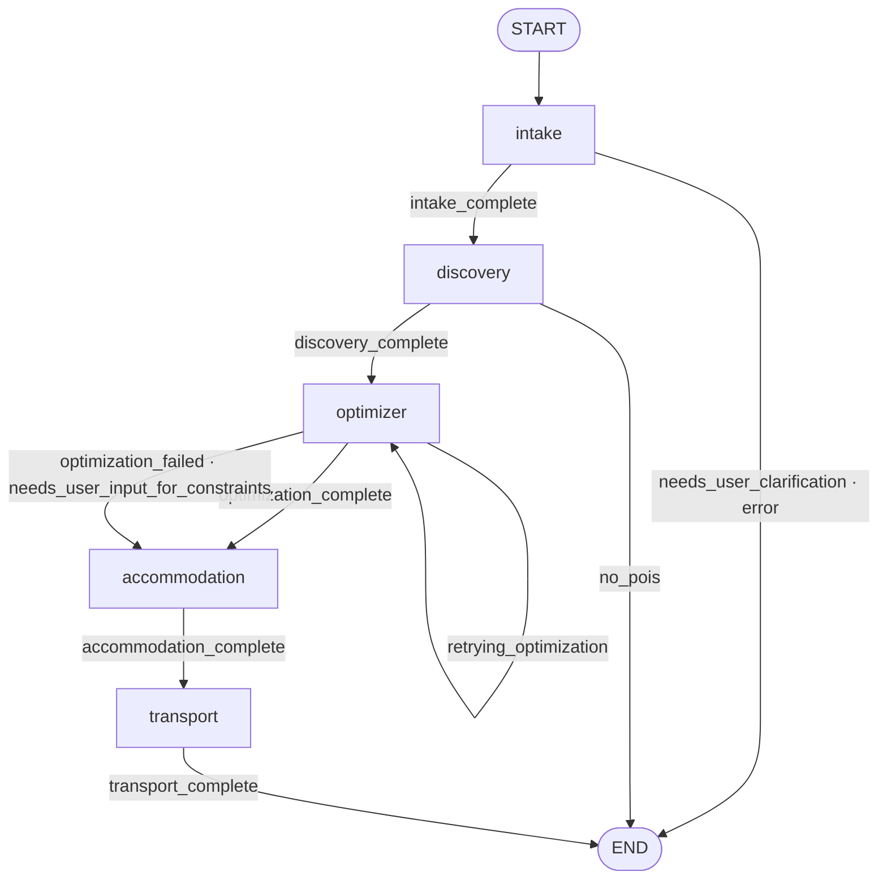
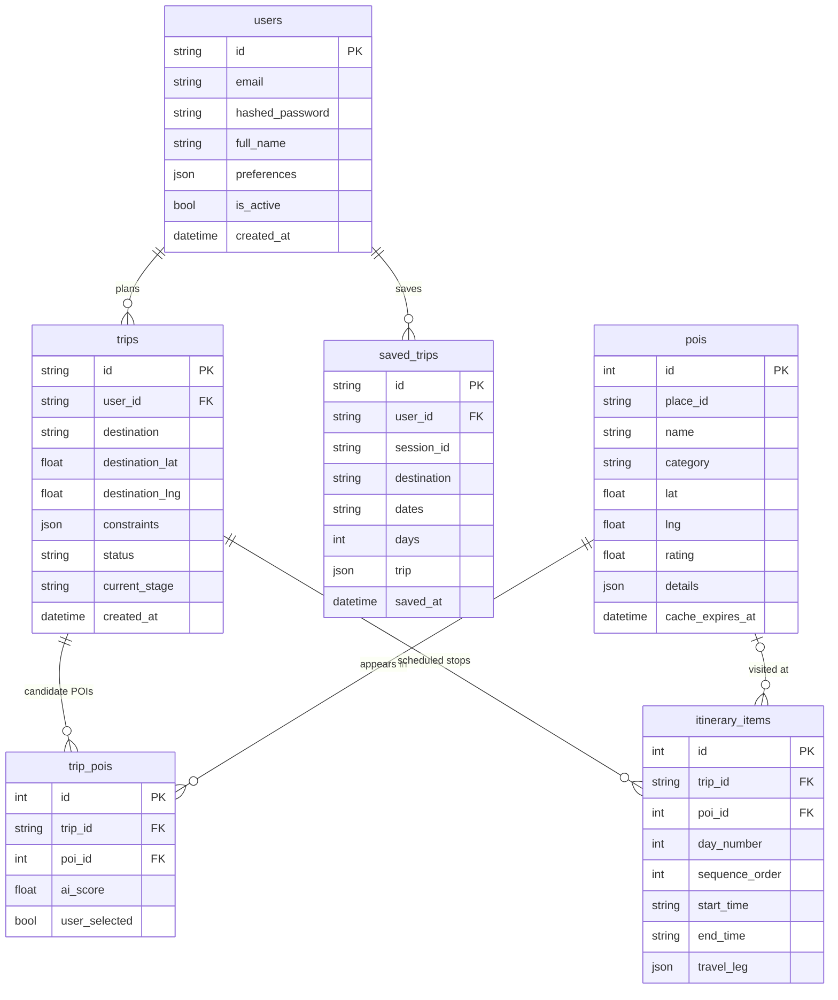

# 🏛️ Deep Technical Architecture & Multi-Agent Specifications

This document covers the agent pipeline, the optimizer, the database schema, caching and provider integrations of the **Intelligent Travel Agent System**. For the big-picture diagrams and the request journey of the web app, start with [How It Works](docs/HOW_IT_WORKS.md).

---

## 🎯 Architecture Overview

The backend has two ways to plan a trip. Both use the same agents and the same provider layer.

| | Step-by-step planner | One-shot planner |
| :--- | :--- | :--- |
| **Endpoints** | `/api/v2/planning/*` (`app/api/routes_planning.py`) | `POST /api/v1/trips`, `POST /api/v2/trips` |
| **Used by** | The React web app | API clients and the test suite |
| **Flow** | The user searches and picks at each step; the backend stores picks in an in-memory session | One request runs the whole LangGraph graph |
| **Day building** | `ItineraryAgent` (`app/agents/itinerary.py`): Gemini groups the picks into days, then searchapi.io adds local transport details | `optimizer` node: Google OR-Tools VRPTW |
| **State** | `planning_sessions` dict in server memory (lost on restart) | In memory plus PostgreSQL (`trips`, `pois`, `trip_pois`, `itinerary_items`) |

---

## 🤖 LangGraph Multi-Agent Workflow (one-shot planner)

The graph is defined in `backend/app/agents/graph.py`. After every node, `should_continue()` reads `current_stage` from the `TravelAgentState` and picks the next node.

If the optimizer cannot produce a schedule, the graph still runs accommodation and transport, so the caller at least gets hotels and flights.

### **Graph Nodes Specification:**

| Node Name | Code | Responsible Logic | Output |
| :--- | :--- | :--- | :--- |
| **`intake`** | `intake_node` in `app/agents/graph.py`, using `app/agents/intake.py` | Gemini extracts destination, dates, budget, vibe, travelers, amenities and must-see list (V1 free text) or refines structured V2 input. Geocodes the destination. | `constraints`, destination coordinates |
| **`discovery`** | `discovery_node` in `graph.py`, using `app/agents/discovery.py` | Searches the configured places provider, removes irrelevant places with a Gemini check (`filter_irrelevant_pois`), boosts must-see matches, ranks and keeps the top 30. | `potential_pois` |
| **`optimizer`** | `app/agents/optimizer.py` + `app/services/optimizer.py` | Solves a VRPTW with OR-Tools over up to 8 POIs. Retries with relaxed settings when infeasible. | `itinerary` (day-by-day stops) |
| **`accommodation`** | `app/agents/accommodation.py` | Searches hotels through the places provider (`GooglePlacesHotelProvider`, which follows `MAPS_PROVIDER`), measures travel time to the itinerary POIs via the routing provider, scores location, price and rating, and writes a Gemini summary. | `recommended_hotels`, `selected_accommodation` |
| **`transport`** | `app/agents/transport.py` | Finds flights from Google Flights results via searchapi.io and local routes between stops via the routing provider. | `recommended_flights`, `local_transport` |

The step-by-step planner calls these agents directly: `discovery_agent` for places, dining, activities, shopping and wellness (with search queries from `QueryGenerator`), `AccommodationAgent` for hotels, and `transport_agent_node` for transport.

---

## 🧮 Operations Research Optimization (OR-Tools VRPTW)

Used only by the one-shot planner. The model lives in `app/services/optimizer.py`; the retry logic is in `app/agents/optimizer.py`.

### **Mathematical Formulation:**
- **Nodes ($N$)**: A start/end depot and up to 8 candidate POIs (capped to stay within routing-API limits).
- **Decision Variable ($x_{ijk}$)**: Binary, equal to $1$ if day $k$ travels directly from POI $i$ to POI $j$.
- **Time Dimension ($T_i$)**: Arrival time at POI $i$.
- **Constraints:**
  1. **Time Window**: $e_i \le T_i \le l_i$, where $e_i$ is opening time and $l_i$ is closing time.
  2. **Service Time**: $T_j \ge T_i + \text{duration}_i + t_{ij}$, where $t_{ij}$ is the travel time from the configured routing provider (Google Routes or Geoapify).
  3. **Day Bounds**: The day runs from `09:00` to `22:00` by default.
- **Solver limit:** 30 seconds per attempt.

### **Constraint Relaxation on Failure:**
When no feasible schedule exists, the node generates relaxation suggestions, sorted by feasibility, and applies the best one before retrying. It makes up to 3 attempts in total (1 in strict mode):
1. **Extend hours:** widen the day by 2 hours on each side, within `06:00`–`23:00`.
2. **Reduce POIs:** keep 60% of the POIs, at least 3.
3. **Change mode:** switch travel mode to transit.

When attempts run out, the suggestions are returned to the caller instead of an itinerary.

---

## 🗄️ Database Schema & Persistence

PostgreSQL via async SQLAlchemy (`backend/app/db/models.py`), migrated with Alembic (`backend/alembic/versions/`). IDs of users, trips and saved trips are UUID strings; structured fields use JSON columns.

- **`trips`, `pois`, `trip_pois`, `itinerary_items`** hold one-shot planner runs (`StatePersistenceService` in `app/services/state_persistence.py`).
- **`saved_trips`** holds "My trips": a finished step-by-step itinerary the user saved, keyed by the planner `session_id`. Every query is filtered by the signed-in `user_id`.
- **Step-by-step planning sessions are not in the database.** They live in the `planning_sessions` dict in `routes_planning.py`, so a restart or redeploy ends any plan in progress, and multiple server instances do not share sessions.

---

## ⚡ Redis Caching

Managed by `CacheService` (`backend/app/services/cache.py`). Redis is optional: the connection is tested once at startup, and if it fails every cache call returns a miss.

| Key Pattern | Data | TTL | Status |
| :--- | :--- | :--- | :--- |
| `travel:geocode:{hash}` | Geocoding results | 7 days | **In use** (Google and Foursquare services) |
| `travel:route:{hash}` | Travel times and directions | 5 minutes | **In use** (Google Routes and Geoapify providers) |
| `travel:place:{hash}` | Place details | 24 hours | Helper exists, not called |
| `travel:llm:{hash}` | Gemini responses | 30 days | Helper exists, not called |
| `travel:trip:{id}:state` | Graph state | No expiry | Helper exists, not called |

The same Redis also holds the cost tracker's per-user and per-trip counters (kept 30 days). The rate limiter stores its counters there too, but is not attached to any route yet.

**Monitoring:**
- `GET /api/monitoring/cache/stats` queries Redis live and is the reliable "is Redis up" check.
- `GET /api/monitoring/system/health` reports the flag set at startup, so it can still say "healthy" after Redis goes down.

---

## 💳 Provider Integrations & Cost Tracking

| Provider | Purpose | Where it is used | Notes |
| :--- | :--- | :--- | :--- |
| **Places provider** (Google Places, or Foursquare Places when `MAPS_PROVIDER=foursquare`) | Geocoding, place search, hotels | Intake, discovery, accommodation | Geocoding cached; calls counted by the cost tracker |
| **Routing provider** (Google Routes, or Geoapify) | Travel times and routes | Optimizer, accommodation, transport | Routes cached for 5 minutes |
| **Google Gemini** (`GEMINI_MODEL`, default `gemini-3.5-flash`) | Constraint extraction, place filtering, hotel summaries, itinerary grouping, search queries | Most agents | Structured output parsed from fenced or bare JSON |
| **Gemini embeddings** (`gemini-embedding-001`, 768 dims) | POI vectors | `/api/v2/pois/semantic-search` | Pinecone index is created at startup; no planner step writes to it yet |
| **searchapi.io** | Google Flights results, web search | Transport agent, itinerary agent | Up to 5 keys rotated under quota (`SEARCH_API_KEY`, `SEARCH_API_KEY1`..`4`) |
| **Amadeus** (hotels, flights) | Live offers | **Not wired in**: used only by `price_comparison.py` and tests | OAuth2 token valid about 30 minutes |
| **SerpAPI** | Hotel price comparison | **Not wired in**: `price_comparison.py` and tests only | Defaults to the `demo` key |

`CostTracker` (`app/services/cost_tracker.py`) counts calls and their estimated cost per user and trip, for the maps services and Amadeus. Gemini and searchapi.io calls are not tracked.

---

## 🔒 Security & Auth Architecture

- **Auth Strategy:** OAuth2 Bearer tokens (JWT, HS256), valid for 7 days. Planning endpoints also accept guests (`get_current_user_or_guest`).
- **Password Hashing:** Passlib with bcrypt; passwords are truncated to bcrypt's 72-byte limit.
- **JWT secret:** `JWT_SECRET_KEY` falls back to a public placeholder if unset, so it must be set outside local development.
- **Interceptors:** The Axios client (`frontend/src/services/api.ts`) attaches `Authorization: Bearer <token>` and shows Sonner toasts for HTTP 401, 403, 404 and 422 responses.
- **Resource scoping:** `saved_trips` rows are always filtered by the authenticated `user_id`; a request for another user's `session_id` returns 404, never 403, so existence isn't leaked either.
- **Provider key isolation:** `GET /api/v2/planning/photos/{reference}` used to 307-redirect to the Google Places photo URL, which carries `key=<GOOGLE_MAPS_API_KEY>` in the `Location` header — exposing an unrestricted server key to any caller of a public route. It now fetches the image server-side and returns the bytes; only Foursquare references (which decode to a plain, credential-free CDN URL) still redirect.
