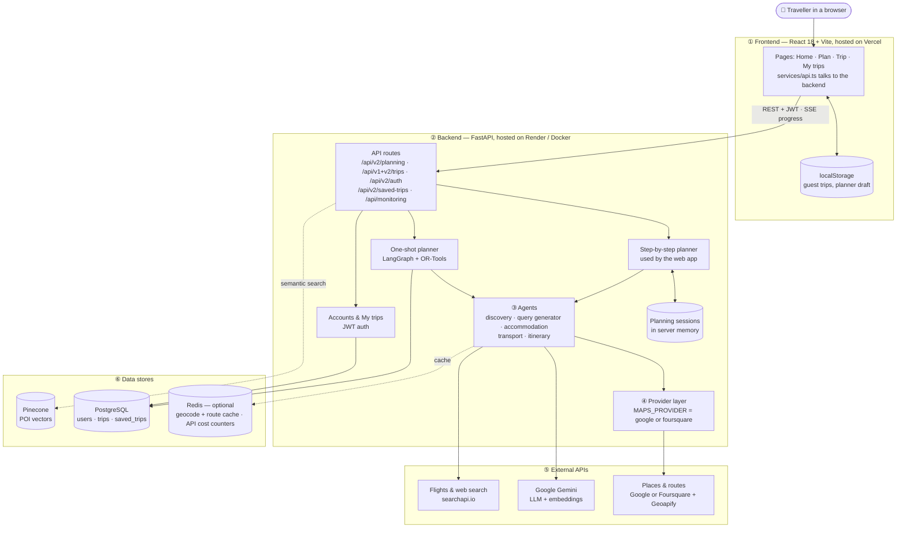
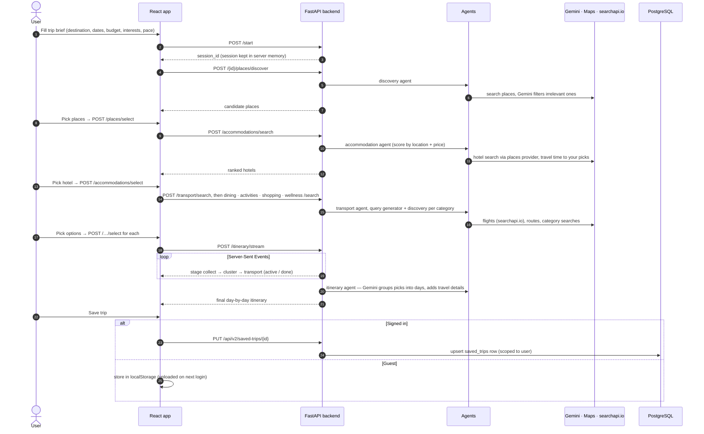
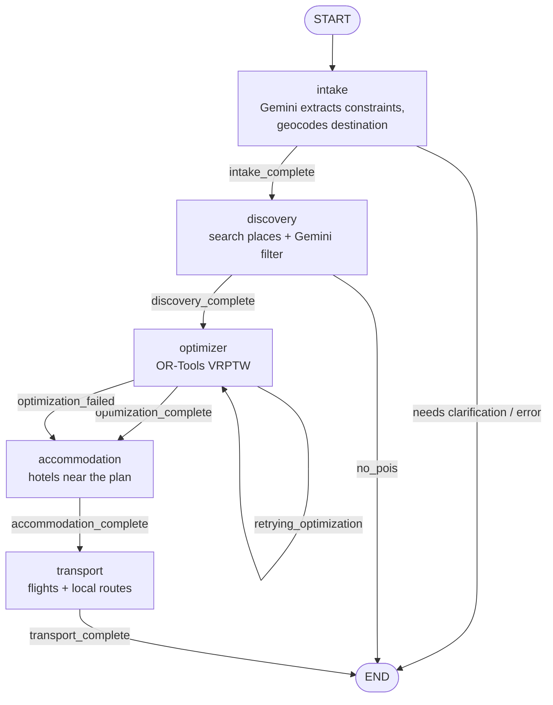
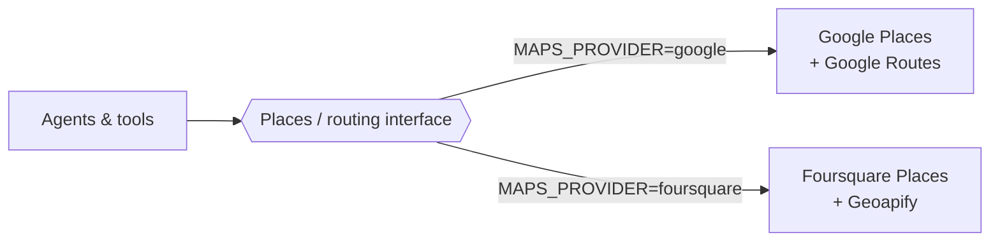

# 🌍 Intelligent Travel Agent System

A production-grade, AI-powered multi-agent travel planning platform built with **LangGraph**, **FastAPI**, **React 18 (Vite + TypeScript)**, **Google OR-Tools**, **PostgreSQL**, **Pinecone** and **Redis**.

---

## 📸 Overview & Value Proposition

The Intelligent Travel Agent System transforms free-form natural language prompts or structured preferences into fully optimized, multi-day travel itineraries. Unlike simple LLM wrappers, the system combines:

1. **AI Agents**: Specialised agents for constraint extraction, place discovery (with Gemini relevance filtering), hotel scoring, flights and local transport, and itinerary building. The one-shot API chains them with **LangGraph**.
2. **Operations Research Optimization (Google OR-Tools)**: The one-shot planner solves a Vehicle Routing Problem with Time Windows (VRPTW) to build daily schedules that honour travel times, visit durations and opening hours. The web app's step-by-step planner uses Gemini to group the user's picks into days instead.
3. **Swappable Data Providers**: Agents are written against provider interfaces, not vendors. Places, hotels and routing run on **either** Google Maps Platform **or** a zero-cost Foursquare + Geoapify stack, selected by a single environment variable — no agent code changes.
4. **Live Travel Data**: Hotels come from the places provider and flights from Google Flights results via searchapi.io. A Pinecone index backs a separate semantic POI search endpoint.
5. **Streaming Multi-Step UI**: A React 18 frontend that streams planning progress over SSE, with an interactive Leaflet map and day-by-day itinerary.

---

## 🧭 How It Works — Architecture at a Glance

**In one sentence:** the browser asks the backend for places, hotels and transport one step at a time, the user picks what they like at each step, and the backend then turns those picks into a day-by-day itinerary that the user can save to their account.

### 1. The big picture

Read it top to bottom: the browser talks only to the backend, the backend's agents do the work, and they call external APIs and data stores. Solid arrows are calls; dotted arrows are optional extras.



### 2. What happens when someone plans a trip in the web app

This is the path the React app actually uses (`/api/v2/planning`). Each numbered step is one screen in the planner.



### 3. The two planning engines

The repository contains two ways to build a trip. They share the same agents and providers.

| | Step-by-step planner | One-shot planner |
| :--- | :--- | :--- |
| **Endpoints** | `/api/v2/planning/*` | `POST /api/v1/trips`, `POST /api/v2/trips` |
| **Used by** | The React web app | API clients and the test suite |
| **User involvement** | User picks places, hotel, transport at each step | None — one request in, full plan out |
| **How days are built** | `ItineraryAgent`: Gemini clusters the picks into days | LangGraph graph with the OR-Tools VRPTW optimizer |
| **Where state lives** | In-memory `planning_sessions` dict | `trips` table in PostgreSQL |

The one-shot planner runs this LangGraph graph (`backend/app/agents/graph.py`). The node after each step is chosen from `current_stage`:



If the optimizer cannot find a feasible schedule, the graph still continues to accommodation and transport, so the user at least gets hotels and flights.

### 4. Where data lives

| Data | Stored in | Lifetime | Notes |
| :--- | :--- | :--- | :--- |
| Active planning session (step-by-step planner) | Backend memory (`planning_sessions`) | Until the server restarts | Lost on restart or redeploy; not shared between server instances |
| User accounts | PostgreSQL `users` | Permanent | Passwords hashed with bcrypt |
| One-shot trips | PostgreSQL `trips`, `pois`, `trip_pois`, `itinerary_items` | Permanent | Also kept in server memory for quick reads |
| Saved trips ("My trips") | PostgreSQL `saved_trips` | Until the user deletes | Always filtered by the signed-in user |
| Guest trips | Browser `localStorage` | Until cleared | Uploaded to the account on login |
| Geocoding and route results | Redis `travel:geocode:*`, `travel:route:*` | 7 days / 5 min | See [Caching](#-3-caching--cost-tracking); optional |
| API cost counters | Redis | 30 days | Not recorded when Redis is down |
| POI embeddings | Pinecone | Permanent | Read by `/api/v2/pois/semantic-search`; no planner step writes to it yet, so the index can be empty |

### 5. How the provider switch works

Agents never call Google or Foursquare directly. They call one interface, and `MAPS_PROVIDER` decides which implementation answers.



### 6. What happens when something fails

| If this is down | What the user sees | Why |
| :--- | :--- | :--- |
| Redis | Everything works, with more provider calls and no cost counters | Checked once at startup; cache calls return "miss" |
| PostgreSQL | Planning still works; login and saving trips fail | Planning sessions live in memory |
| Gemini | Discovery filtering and itinerary building fail or fall back | Gemini is the core LLM |
| Maps provider | No places or routes | Switch `MAPS_PROVIDER` to the other stack |
| searchapi.io | No flight options, less transport detail | Other steps continue |
| Backend restarted mid-plan | "Session not found"; the planner must start again | Sessions are in memory |

Quick checks: `GET /api/v1/health/live` (is the server up), `GET /api/monitoring/cache/stats` (is Redis answering right now), `GET /api/v1/health` (do Gemini and the maps provider respond — uses quota).

---

## 🏗️ Repository Architecture

```
TravelAgent/
├── README.md                      <- Primary System Guide & Quickstart (This File)
├── ARCHITECTURE.md                <- Deep Technical Architecture & Multi-Agent Flow Specs
├── docker-compose.yml             <- Local stack: Postgres, Redis, backend, frontend
├── render.yaml                    <- Render blueprint: web service + Postgres + Key Value
├── start_app.bat                  <- Windows Dual-Service Dev Server Launcher
│
├── backend/                       <- FastAPI & LangGraph Python Service
│   ├── app/
│   │   ├── agents/                <- LangGraph nodes (intake, discovery, query_generator,
│   │   │                             accommodation, transport, itinerary, optimizer)
│   │   ├── api/                   <- FastAPI REST routes (v1, v2, planning/SSE, monitoring)
│   │   ├── db/                    <- SQLAlchemy async models & database sessions
│   │   ├── models/                <- Pydantic API schemas & TravelAgentState TypedDict
│   │   ├── services/              <- Gemini, places/routing providers, cache, cost tracker,
│   │   │   └── providers/            vector store, rate limiter
│   │   ├── tools/                 <- Geocoding, places and semantic-search wrappers
│   │   ├── config.py              <- Pydantic settings (all environment variables)
│   │   └── main.py                <- Uvicorn application entrypoint
│   ├── tests/                     <- PyTest integration & unit suite
│   ├── alembic/                   <- Database schema migrations
│   ├── Dockerfile                 <- Multi-stage production image
│   ├── env.example                <- Annotated environment template
│   └── requirements.txt           <- Python dependencies
│
└── frontend/                      <- React 18 + Vite + TypeScript Web Application
    ├── src/
    │   ├── components/
    │   │   ├── landing/           <- Apparatus, MeterStrip, SystemMap (hand-built SVG)
    │   │   ├── planning/          <- StepRail, SelectionStep, TripBrief, TripPrompt, progress
    │   │   ├── trip/              <- ItineraryTimeline, DaySelector, Flight/Hotel cards, MapPanel
    │   │   └── shared/            <- Navbar, Footer, CommandPalette, LoginModal, states
    │   ├── contexts/              <- AuthContext (JWT session, migrates local trips on login)
    │   ├── lib/                   <- Trip model/parser, planning steps & storage, saved-trips, theme, format
    │   ├── routes/                <- HomePage, PlanPage, TripPage, TripsPage
    │   ├── services/              <- api.ts (REST client + SSE stream)
    │   ├── index.css              <- Tailwind v4 layers & component primitives
    │   └── main.tsx               <- React DOM entrypoint
    ├── tokens.css                 <- Design tokens consumed by Tailwind v4 @theme
    ├── vercel.json                <- Vercel SPA rewrites & asset caching
    └── vite.config.ts             <- Vite configuration
```

For complete technical specifications, state graph definitions, and database schemas, refer to [ARCHITECTURE.md](ARCHITECTURE.md).

---

## ✨ System Capabilities

### 🤖 **1. Autonomous Multi-Agent Graph (LangGraph)**
- **Intake Node:** Gemini extracts constraints (destination, dates, travelers, budget, vibe, must-see preferences) from natural language or structured forms, then the destination is geocoded.
- **Discovery Node:** Searches the configured places provider, removes irrelevant results with a Gemini check (`filter_irrelevant_pois`), boosts must-see matches and keeps the top 30.
- **Optimizer Node:** Builds a VRPTW model from up to 8 candidate POIs and solves it with Google OR-Tools (09:00–22:00 days, 30 s limit). If no schedule fits, it retries up to 3 times with relaxed settings: longer days, fewer POIs, or transit instead of driving.
- **Accommodation Node:** Searches hotels through the places provider and scores them on travel time to the chosen POIs, budget fit and rating, with a Gemini summary.
- **Transport Node:** Fetches flight options from Google Flights results via searchapi.io, and local routes between stops from the routing provider.
- **Not yet wired in:** Amadeus hotel and flight providers and a SerpAPI price-comparison service are implemented under `app/services/`, but no planner step calls them.

### 🔄 **2. Provider Abstraction**
`MAPS_PROVIDER` selects the places and routing backend at startup:

| Value | Places | Geocoding & routing | Cost |
| :--- | :--- | :--- | :--- |
| `google` *(default)* | Google Places (places and hotels) | Google Routes | Billing account required |
| `foursquare` | Foursquare Places (places and hotels) | Geoapify | Free tier, no card |

Both implementations satisfy the same interface and return the same shapes, so the agent graph, tools and API responses are identical either way.

### ⚡ **3. Caching & Cost Tracking**
- **In use:** Redis caches geocoding results (7 days) and routes (5 min) for both provider stacks.
- **Available but not called yet:** helpers for place details (24 h), LLM responses (30 days) and session state exist in `CacheService`.
- **Cost Tracker:** Counts maps-provider calls and their estimated cost per user and per trip in Redis; see `/api/monitoring/cost/*`.
- **Rate limiter:** Implemented and reported by `/api/monitoring/ratelimit/status`, but not yet enforced on any route.

Redis is **optional everywhere** — if it is unreachable at startup the app logs a warning and runs uncached. The connection is checked only at startup, so `/api/monitoring/cache/stats` is the reliable live check.

### 🎨 **4. React 18 Web App**
- **Landing page:** Hand-built SVG system map and apparatus diagrams showing the actual planning pipeline.
- **Planning flow:** A step rail over selection steps, with progress streamed live from the backend over SSE.
- **Itinerary view:** Day selector over a timeline, with flight, hotel, local transport and Leaflet map panels.
- **Theming:** Tailwind v4 `@theme` driven by `tokens.css`, with a light/dark toggle.

### 💾 **5. Saved Trips Follow the Account**
"My trips" is backed by a `saved_trips` table (`/api/v2/saved-trips`), scoped to the signed-in user — a trip follows the account to another device, and another user's session id reads as missing rather than forbidden. Guests without an account still get "My trips" via a localStorage fallback; on login, any locally saved trips are uploaded to the account and the local copies are dropped.

---

## 🛠️ Quick Start Guide

### **Prerequisites**

**With Docker (recommended):** Docker Engine 24+ with Compose v2. Nothing else — Postgres and Redis come up with the stack.

**Without Docker:**
- **Python:** 3.12 (the image and CI use 3.12; 3.11 works)
- **Node.js:** 18.0.0 or higher
- **PostgreSQL:** 14+
- **Redis:** 6+ (optional, graceful degradation supported)

---

### **0. Docker Quickstart**

```bash
cp backend/env.example backend/.env   # then fill in your API keys
docker compose up --build
```

| Service  | URL                               |
| :------- | :-------------------------------- |
| Frontend | http://localhost:3000             |
| API docs | http://localhost:8000/docs        |
| Postgres | `localhost:5432` (`travel_agent`) |
| Redis    | `localhost:6379`                  |

The backend mounts `./backend` and runs with `--reload`, so edits apply without a rebuild. The frontend is served by nginx from a production build; since Vite inlines `VITE_API_URL` at build time, changing the API URL means rebuilding that image (`docker compose build frontend`).

The remaining sections cover running the services directly on your machine.

---

### **1. Environment Configuration**

`backend/env.example` is the annotated source of truth — copy it rather than retyping. Variable names below match `app/config.py` exactly.

#### **Backend `.env` (`backend/.env`)**
```ini
# --- Maps / places provider ---
# "google" needs billing enabled; "foursquare" runs on free tiers with no card.
MAPS_PROVIDER=foursquare
GOOGLE_MAPS_API_KEY=            # required only when MAPS_PROVIDER=google
FOURSQUARE_API_KEY=             # required only when MAPS_PROVIDER=foursquare
GEOAPIFY_API_KEY=               # required only when MAPS_PROVIDER=foursquare

# --- AI ---
GEMINI_API_KEY=your_gemini_api_key          # aistudio.google.com/apikey
PINECONE_API_KEY=your_pinecone_api_key      # index is created automatically

# --- Travel inventory ---
SEARCH_API_KEY=your_searchapi_io_key        # flights + web search (used)
AMADEUS_API_KEY=your_amadeus_api_key        # optional: providers not wired in yet
AMADEUS_API_SECRET=your_amadeus_api_secret  # optional
SERPAPI_API_KEY=your_serpapi_key            # optional: price comparison, not wired in yet

# --- Database ---
DATABASE_HOST=localhost
DATABASE_PORT=5432               # the code default is 5433, so set this explicitly
DATABASE_NAME=travel_agent
DATABASE_USER=postgres
DATABASE_PASSWORD=postgres

# --- Cache (optional) ---
# Hosted Redis: set REDIS_URL to the provider's connection string and it wins
# over the host/port pair. Use rediss:// over the public internet.
# REDIS_URL=
REDIS_HOST=localhost
REDIS_PORT=6379

# --- Security ---
JWT_SECRET_KEY=generate_a_long_random_value  # falls back to a public placeholder if unset
```

#### **Frontend `.env` (`frontend/.env`)**
```ini
VITE_API_URL=http://127.0.0.1:8000/api
```

The `/api` suffix is required — the client appends paths directly to this value. The map uses Leaflet with OpenStreetMap tiles, so no frontend map key is needed.

---

### **2. Running Local Dev Servers**

#### **Option A: Automatic Launcher (Windows)**
```cmd
start_app.bat
```

#### **Option B: Manual Terminal Execution**

**Terminal 1 — Backend (FastAPI):**
```bash
cd backend
python -m venv venv
# Windows: venv\Scripts\activate | Linux/macOS: source venv/bin/activate
pip install -r requirements.txt
uvicorn app.main:app --reload --host 0.0.0.0 --port 8000
```
- API docs: [http://127.0.0.1:8000/docs](http://127.0.0.1:8000/docs)

**Terminal 2 — Frontend (Vite + React):**
```bash
cd frontend
npm install
npm run dev
```
- Web app: [http://localhost:5173](http://localhost:5173)

---

## 🚀 Deployment

The frontend deploys to Vercel as a static SPA; the backend needs a container host, because OR-Tools plus the LangGraph stack exceeds serverless bundle limits and the SSE planning stream needs a long-lived connection.

`render.yaml` provisions the whole backend — web service, Postgres and Redis — as one blueprint.

**1. Backend (Render)**
1. Push the branch to GitHub.
2. Render dashboard → **New → Blueprint** → select the repository.
3. Fill in the secrets marked `sync: false`. `DATABASE_*` and `REDIS_URL` are wired automatically from the managed services; `JWT_SECRET_KEY` is generated.
4. Leave `CORS_ORIGINS` blank until the frontend URL exists.

The container's start command runs `alembic upgrade head` before starting Uvicorn, so the schema is always current on deploy — Render's free plan has no separate pre-deploy hook. The upgrade is idempotent; if it fails, it logs and starts anyway (planning still works, persistence doesn't). `docker compose` runs the same step, so a fresh local volume isn't left with an empty database either.

**2. Frontend (Vercel)**
1. Import the repository, set the root directory to `frontend`.
2. Set `VITE_API_URL` to `https://<your-render-service>.onrender.com/api`.
3. Deploy. `vercel.json` handles SPA rewrites and asset caching.

**3. Close the loop**
Set `CORS_ORIGINS` on Render to the Vercel URL and redeploy. A wrong value here appears as browser CORS failures, not server errors.

### Health endpoints

| Path | Cost | Use |
| :--- | :--- | :--- |
| `/api/v1/health/live` | Free — touches no provider | Container and platform health checks |
| `/api/v1/health` | Calls Gemini + the maps provider | On-demand dependency verification |

Point automated checks at `/health/live`. Polling `/health` on an interval will consume free-tier API quota continuously.

### Free-tier notes

- Render free web services sleep after ~15 minutes idle; the first request afterwards pays a cold start while OR-Tools and LangGraph load.
- Free Postgres instances expire — check Render's current terms before relying on one.
- Free Key Value is small and non-persistent, which is correct for a cache but not for anything that must survive a restart.

---

## 🧪 Testing Strategy

Most tests call the real providers, so they need valid keys in `backend/.env` and use API quota. `test_caching.py` and `test_end_to_end.py` also expect the backend to be running on `http://localhost:8000`.

Run the complete backend test suite:
```bash
cd backend
pytest tests/ -v
```

Run specific test modules:
```bash
# Multi-agent end-to-end integration test
pytest tests/test_phase2_end_to_end.py -v

# OR-Tools optimizer test
pytest tests/test_optimizer.py -v

# Routing provider test
pytest tests/test_google_routes.py -v
```

---

## 📑 Complete Documentation Links

- 🏛️ [System Architecture & Agent Specs](ARCHITECTURE.md)
- ⚙️ [Backend Service Documentation](backend/README.md)
- 💻 [Frontend Web App Documentation](frontend/README.md)

---

## 📜 License
This project is licensed under the MIT License.
