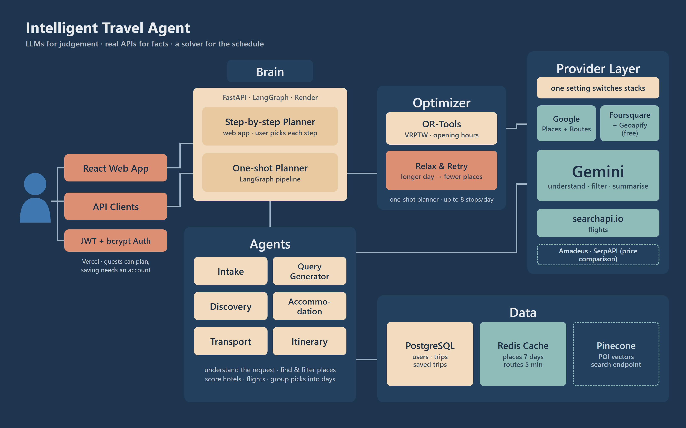

# 🌍 Intelligent Travel Agent — Multi-Agent Trip Planning


**Intelligent Travel Agent** turns a plain-English trip request into a day-by-day itinerary with places, hotels, flights and routes. LLM agents handle the judgement (what the traveller wants, which places fit), real APIs supply the facts (places, opening hours, travel times, flights), and a Google OR-Tools solver fits each day around opening hours and travel time.

🔗 **Live demo:** [travel-agent-six-theta.vercel.app](https://travel-agent-six-theta.vercel.app/)

---

## 📑 Table of Contents

* [📌 Overview](#-overview)
* [✨ Key Features](#-key-features)
* [🧩 Architecture & Workflow](#-architecture--workflow)
  * [📊 Diagram](#-diagram)
  * [🔄 Walkthrough (step-by-step)](#-walkthrough-step-by-step)
  * [⚙️ Two ways to plan](#️-two-ways-to-plan)
* [🛠️ Tech Stack](#️-tech-stack)
* [📂 Repository Layout](#-repository-layout)
* [⚡ Quickstart](#-quickstart)
* [🚀 Deployment](#-deployment)
* [🧪 Testing](#-testing)
* [🔐 Security Notes](#-security-notes)
* [🔮 Future Work](#-future-work)

---

## 📌 Overview

Ask a plain LLM to plan a trip and it writes something that *sounds* right but may send you to a museum that is closed, or put two places 90 minutes apart in one morning. This project splits the work: Gemini-powered agents understand the request and filter real search results, map APIs provide real places and travel times, and an operations-research solver builds schedules that actually fit the day. Every external service sits behind an interface, so the whole maps stack can be swapped with one setting.

---

## ✨ Key Features

* 🤖 **Multi-agent pipeline (LangGraph)**: intake, discovery, optimizer, accommodation and transport agents share one trip state.
* 🔍 **Grounded discovery**: places come from a real places API; Gemini only filters out irrelevant results, so nothing is invented.
* 🧮 **OR-Tools scheduling**: a Vehicle Routing Problem with Time Windows (VRPTW) fits up to 8 stops a day around opening hours, relaxing and retrying when a plan is impossible.
* 🔄 **Swappable providers**: Google Places + Routes, or the free Foursquare + Geoapify stack, chosen by `MAPS_PROVIDER`.
* 🏨 **Hotels & flights**: hotels scored on distance to your plan, price and rating; flights from Google Flights results via searchapi.io.
* ⚡ **Smart caching**: Redis keeps locations for 7 days and travel times for 5 minutes, and the app runs fine without it.
* 📡 **Live progress**: the final itinerary streams to the browser over Server-Sent Events.
* 💾 **Saved trips**: trips follow your account across devices; guests can plan without signing up.

---

## 🧩 Architecture & Workflow

### 📊 Diagram



> System architecture: clients, the planning brain, agents, optimizer, provider layer and data stores. Dashed boxes are integrated but not used by the planners.

### 🔄 Walkthrough (step-by-step)

Example: *"3 days in Jaipur, 2 people, moderate budget, I like culture and food."*

1. **Trip brief** 📝
   * The web app reads the sentence and fills in destination, dates, travellers and budget.

2. **Discovery** 🔍
   * The Query Generator writes focused searches ("historic forts in Jaipur").
   * The places provider returns real results; Gemini removes irrelevant ones and the best are ranked.
   * The traveller picks the places they want.

3. **Accommodation** 🏨
   * Hotels near the picked places are scored on travel time, price and rating, with a short Gemini summary.

4. **Dining, transport & extras** ✈️
   * The same search-and-filter runs for food, activities, shopping and wellness.
   * Flights come from Google Flights results via searchapi.io; routes from the routing provider.

5. **Itinerary** 🗓️
   * The itinerary agent groups the picks into sensible days and adds how to get between stops.
   * Progress streams live to the browser.

6. **Save** 💾
   * Signed-in users save the trip to their account; guests keep it in the browser until they log in.

### ⚙️ Two ways to plan

| | Step-by-step planner | One-shot planner |
| :--- | :--- | :--- |
| **Used by** | The web app | API clients and tests |
| **Who picks places** | The traveller, at each step | The agents |
| **How days are built** | Gemini groups the picks into days | OR-Tools VRPTW solver |
| **Flow** | One screen per step | `intake → discovery → optimizer → accommodation → transport` |

If the solver finds no feasible schedule, it widens the day and then drops places, retrying up to 3 times; if it still fails, the pipeline continues so you still get hotels and flights.

📖 Full request flows, data lifetimes and failure behaviour: [docs/HOW_IT_WORKS.md](docs/HOW_IT_WORKS.md). Agent specs, the optimizer model and the database schema: [ARCHITECTURE.md](ARCHITECTURE.md).

---

## 🛠️ Tech Stack

| Layer | Tools |
| :--- | :--- |
| 🧠 Agents & LLM | LangGraph, LangChain, Google Gemini |
| 🧮 Optimization | Google OR-Tools (VRPTW) |
| ⚙️ Backend | Python 3.12, FastAPI, SQLAlchemy (async), Alembic |
| 🗺️ Providers | Google Places + Routes, or Foursquare + Geoapify; searchapi.io |
| 💾 Data | PostgreSQL, Redis, Pinecone |
| 💻 Frontend | React 18, Vite, TypeScript, Tailwind CSS, Leaflet |
| 🚀 Hosting | Render (API, Postgres, Redis), Vercel (web app) |

---

## 📂 Repository Layout

```
TravelAgent/
├── backend/
│   ├── app/
│   │   ├── agents/        # intake, discovery, query generator, optimizer,
│   │   │                  # accommodation, transport, itinerary + LangGraph graph
│   │   ├── api/           # REST routes, planning + SSE stream, monitoring
│   │   ├── services/      # Gemini, providers, optimizer, cache, cost tracker
│   │   ├── db/            # SQLAlchemy models and sessions
│   │   └── main.py        # FastAPI entrypoint
│   ├── alembic/           # database migrations
│   ├── tests/             # pytest suite
│   └── env.example        # annotated environment template
├── frontend/
│   └── src/               # routes, planning steps, itinerary view, API client
├── docs/                  # architecture image, how-it-works guide
├── ARCHITECTURE.md        # deep technical reference
├── docker-compose.yml     # local stack: Postgres, Redis, backend, frontend
└── render.yaml            # one-click Render blueprint
```

---

## ⚡ Quickstart

**Prerequisites**

* 🐳 Docker with Compose v2 (easiest), **or**
* 🐍 Python 3.12, 🌐 Node.js 18+, 🐘 PostgreSQL 14+, and optionally Redis 6+
* 🔑 API keys: Gemini, searchapi.io, and either Google Maps or Foursquare + Geoapify

**Run with Docker**

```bash
git clone https://github.com/vaibhavdabas16/TravelAgent.git
cd TravelAgent
cp backend/env.example backend/.env   # then add your keys
docker compose up --build
```

Web app: http://localhost:3000 · API docs: http://localhost:8000/docs

**Run without Docker**

```bash
# Backend
cd backend
python -m venv venv
venv\Scripts\activate            # Windows
source venv/bin/activate         # macOS/Linux
pip install -r requirements.txt
uvicorn app.main:app --reload --port 8000

# Frontend (new terminal)
cd frontend
npm install
npm run dev                      # http://localhost:5173
```

**Environment** (`backend/.env`; the full annotated list is in `backend/env.example`)

```bash
MAPS_PROVIDER=foursquare          # or "google" (needs billing)
FOURSQUARE_API_KEY=your-key       # when MAPS_PROVIDER=foursquare
GEOAPIFY_API_KEY=your-key         # when MAPS_PROVIDER=foursquare
GOOGLE_MAPS_API_KEY=your-key      # when MAPS_PROVIDER=google
GEMINI_API_KEY=your-key
SEARCH_API_KEY=your-key           # searchapi.io, for flights
DATABASE_HOST=localhost
DATABASE_PORT=5432
JWT_SECRET_KEY=a-long-random-value
```

Frontend: set `VITE_API_URL=http://127.0.0.1:8000/api` in `frontend/.env`.

---

## 🚀 Deployment

* ⚙️ **Backend → Render**: *New → Blueprint* and pick this repo. `render.yaml` creates the API, Postgres and Redis; fill in the API keys. Migrations run on every start.
* 💻 **Frontend → Vercel**: root directory `frontend`, and set `VITE_API_URL` to `https://<your-render-service>.onrender.com/api`.
* 🔗 **Connect them**: set `CORS_ORIGINS` on Render to your Vercel URL.
* ❤️ **Health**: point uptime checks at `/api/v1/health/live`. `/api/v1/health` calls Gemini and the maps provider, so it uses quota.

> Render's free plan sleeps after about 15 minutes idle, so the first request after that is slow.

---

## 🧪 Testing

```bash
cd backend
pytest tests/ -v                          # full suite (uses real APIs and quota)
pytest tests/test_optimizer.py -v         # OR-Tools optimizer
pytest tests/test_phase2_end_to_end.py -v # multi-agent end to end
```

---

## 🔐 Security Notes

* 🔑 Passwords are hashed with bcrypt; sessions use JWTs. Always set `JWT_SECRET_KEY` in production.
* 🙈 Users only ever see their own saved trips; another user's trip reads as "not found".
* 🖼️ Place photos are proxied through the server, so the maps API key never reaches the browser.
* ❌ Never commit `.env`; share configuration through `env.example`.

---

## 🔮 Future Work

* 🧭 Use the OR-Tools optimizer in the web app's step-by-step planner too.
* 💾 Keep planning sessions in Redis so they survive restarts and scale across instances.
* ✈️ Wire the Amadeus hotel and flight providers into the planners.
* 🔍 Feed discovered places into Pinecone for semantic search.
* 🚦 Turn on per-user rate limiting.

---

## 📜 License

MIT
