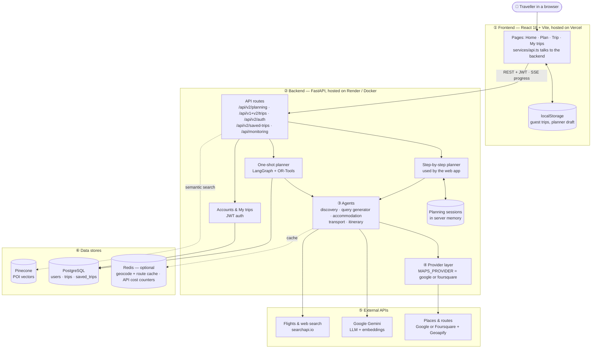
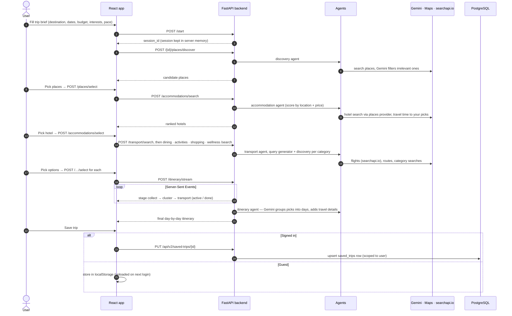
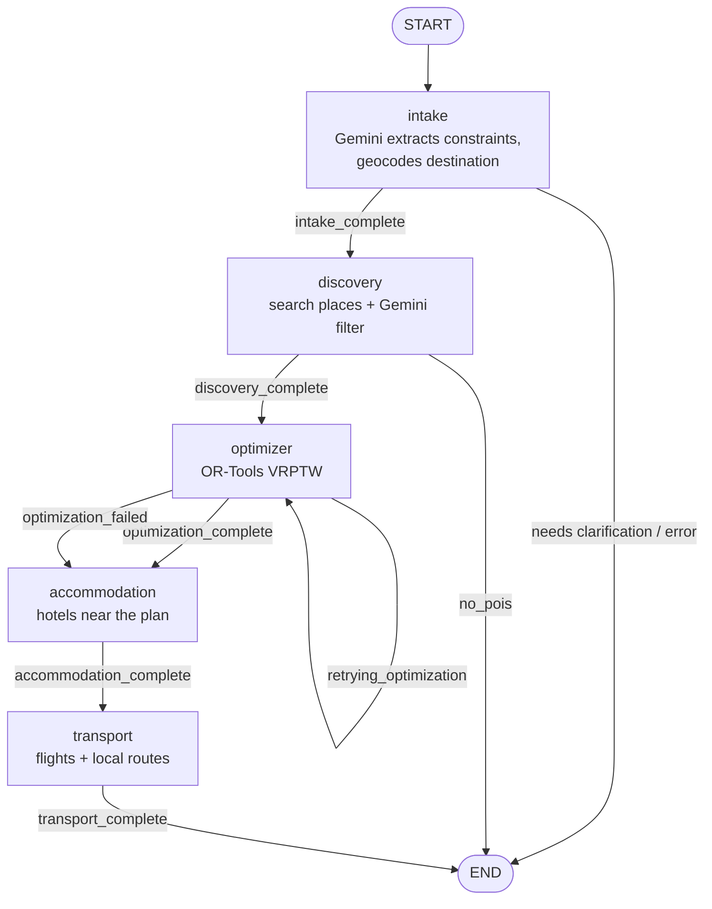
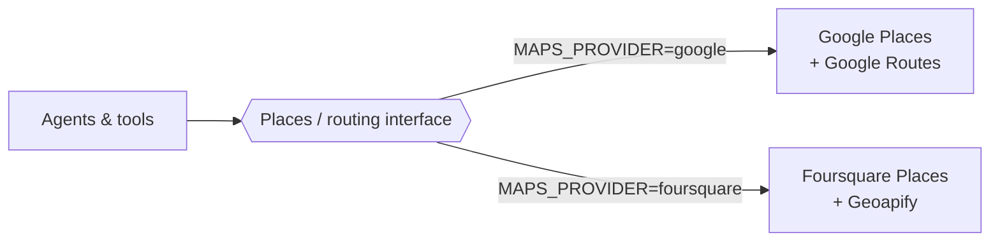

# How It Works

The detailed version of the architecture in the [README](../README.md): every request path, both planning engines, where data lives, and what happens when a dependency fails. For agent specs, the optimizer model and the database schema, see [ARCHITECTURE.md](../ARCHITECTURE.md).

**In one sentence:** the browser asks the backend for places, hotels and transport one step at a time, the user picks what they like at each step, and the backend then turns those picks into a day-by-day itinerary that the user can save to their account.

## 1. The big picture

Read it top to bottom: the browser talks only to the backend, the backend's agents do the work, and they call external APIs and data stores. Solid arrows are calls; dotted arrows are optional extras.

## 2. What happens when someone plans a trip in the web app

This is the path the React app actually uses (`/api/v2/planning`). Each numbered step is one screen in the planner.

## 3. The two planning engines

The repository contains two ways to build a trip. They share the same agents and providers.

| | Step-by-step planner | One-shot planner |
| :--- | :--- | :--- |
| **Endpoints** | `/api/v2/planning/*` | `POST /api/v1/trips`, `POST /api/v2/trips` |
| **Used by** | The React web app | API clients and the test suite |
| **User involvement** | User picks places, hotel, transport at each step | None — one request in, full plan out |
| **How days are built** | `ItineraryAgent`: Gemini clusters the picks into days | LangGraph graph with the OR-Tools VRPTW optimizer |
| **Where state lives** | In-memory `planning_sessions` dict | `trips` table in PostgreSQL |

The one-shot planner runs this LangGraph graph (`backend/app/agents/graph.py`). The node after each step is chosen from `current_stage`:

If the optimizer cannot find a feasible schedule, the graph still continues to accommodation and transport, so the user at least gets hotels and flights.

## 4. Where data lives

| Data | Stored in | Lifetime | Notes |
| :--- | :--- | :--- | :--- |
| Active planning session (step-by-step planner) | Backend memory (`planning_sessions`) | Until the server restarts | Lost on restart or redeploy; not shared between server instances |
| User accounts | PostgreSQL `users` | Permanent | Passwords hashed with bcrypt |
| One-shot trips | PostgreSQL `trips`, `pois`, `trip_pois`, `itinerary_items` | Permanent | Also kept in server memory for quick reads |
| Saved trips ("My trips") | PostgreSQL `saved_trips` | Until the user deletes | Always filtered by the signed-in user |
| Guest trips | Browser `localStorage` | Until cleared | Uploaded to the account on login |
| Geocoding and route results | Redis `travel:geocode:*`, `travel:route:*` | 7 days / 5 min | Optional; see [ARCHITECTURE.md](../ARCHITECTURE.md#-redis-caching) |
| API cost counters | Redis | 30 days | Not recorded when Redis is down |
| POI embeddings | Pinecone | Permanent | Read by `/api/v2/pois/semantic-search`; no planner step writes to it yet, so the index can be empty |

## 5. How the provider switch works

Agents never call Google or Foursquare directly. They call one interface, and `MAPS_PROVIDER` decides which implementation answers.

## 6. What happens when something fails

| If this is down | What the user sees | Why |
| :--- | :--- | :--- |
| Redis | Everything works, with more provider calls and no cost counters | Checked once at startup; cache calls return "miss" |
| PostgreSQL | Planning still works; login and saving trips fail | Planning sessions live in memory |
| Gemini | Discovery filtering and itinerary building fail or fall back | Gemini is the core LLM |
| Maps provider | No places or routes | Switch `MAPS_PROVIDER` to the other stack |
| searchapi.io | No flight options, less transport detail | Other steps continue |
| Backend restarted mid-plan | "Session not found"; the planner must start again | Sessions are in memory |

Quick checks: `GET /api/v1/health/live` (is the server up), `GET /api/monitoring/cache/stats` (is Redis answering right now), `GET /api/v1/health` (do Gemini and the maps provider respond — uses quota).
